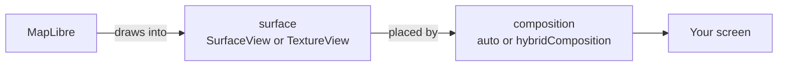

# Startup & Performance

Three things dominate how a map-heavy app feels: how long the first map takes to appear, what the map costs while it is off screen, and how much work a data update does on the UI thread.

## Pre-warm the engine

The map engine initializes when the first `MapLibreMap` is built, and that work lands squarely in the frame the user is waiting for. `MapLibreMap.preWarm()` starts it earlier, so it overlaps app start-up instead:

```dart
void main() {
  MapLibreMap.preWarm(); // fire-and-forget, do not await
  runApp(const MyApp());
}
```

Measured at first map display, this saves roughly 170 to 480 ms on Android, 45 to 165 ms on iOS, and 10 to 50 ms on web, where the cost being moved is the MapLibre GL JS download. The spread is the range across the devices used for those measurements, so treat it as an order of magnitude and profile your own app.

!!! warning "Not for every app"
    Pre-warming is worth it when your **first screen is a map**. An app whose map is a few screens in pays for engine start-up its first screen never uses, and possibly never uses at all. The example app deliberately does not call it, because it opens on a list of examples.

Calling it more than once is harmless. It initializes the Flutter binding if the app has not done so yet, since it runs before `runApp()`; an app or test that needs a specific binding, such as `IntegrationTestWidgetsFlutterBinding`, must initialize that one first.

## Pause maps that are off screen

A map that is alive but not visible keeps rendering, which is a plain waste of GPU and battery. The most common case is a map on an inactive `TabBarView` page, or one behind a full-screen route: the widget is not disposed, so the map keeps running.

```dart
// Leaving the map's tab
await controller.pauseMap();

// Coming back
await controller.resumeMap();
```

On Android this stops the `MapView` render loop; on iOS it drops the preferred frame rate to zero; on web both calls are no-ops, so the code is safe to run unconditionally. A map paused this way stays paused across backgrounding until you call `resumeMap()`, so pair the calls with the visibility change that caused them rather than with app lifecycle events.

## Rendering backend (Android)

MapLibre Android draws with OpenGL ES or Vulkan. The plugin uses OpenGL ES unless the app picks
another backend in `android/gradle.properties`:

```properties title="android/gradle.properties"
maplibre_gl.renderer=auto
```

| Value | Backend | Cost |
|---|---|---|
| `opengl` (default) | OpenGL ES | None: runs on every device and has the longest track record. |
| `vulkan` | Vulkan | Google Play offers the app only to devices with Vulkan 1.0, which leaves out Android 6 (API 23) and older GPUs. |
| `auto` | Vulkan where the device has it, OpenGL ES elsewhere | No device left out, but the app ships both native libraries: about 10 MB more. |

Vulkan is usually faster on modern devices. The choice is made at build time and holds for every
map in the app. With `auto`, MapLibre picks Vulkan on Android 7.0 (API 24) and later when the device
reports Vulkan 1.0 hardware, and keeps it until the process restarts.

!!! warning "Test before shipping"
    Vulkan is MapLibre Android's own default, but it still has
    [open issues](https://github.com/maplibre/maplibre-native/issues?q=is%3Aissue%20state%3Aopen%20label%3AVulkan).
    Test your styles on the Android versions you support, also with a
    `TextureView` surface if your app uses one. When you report a bug, say which
    renderer the app uses.

iOS renders with Metal and web with WebGL, whatever this property says.

## Platform view mode (Android)

On Android, Flutter does not draw the map. MapLibre draws it in a native Android
view, and Flutter places that view among your widgets, as a
[platform view](https://docs.flutter.dev/platform-integration/android/platform-views).
`androidView` sets both steps, for each map:



```dart
MapLibreMap(
  androidView: const AndroidMapView(
    surface: AndroidMapSurface.textureView,
    composition: AndroidComposition.auto,
  ),
)
```

**Most apps should keep the default**, `surfaceView` with `auto`. On some
devices, fast camera moves can stutter or flash with it. Change it only to fix
one of these problems:

| Problem | `surface` | `composition` | What it costs |
|---|---|---|---|
| The map stutters or flashes on fast camera moves | `textureView` | `auto` | The map draws more slowly. On some devices, map updates show up late. |
| Map updates show up late, only when something else on screen moves | `surfaceView` or `textureView` | `hybridComposition` | Flutter renders more slowly while the map is visible, especially on Android 9 and older and on low-end devices. |
| Widgets behind the map should show through it | `translucentTextureView` | `auto` | Like `textureView`, plus blending the map with what is behind it. |

Any `surface` works with any `composition`. A map keeps the view of its first
build: changing `androidView` later does not affect a map already on screen.

### What each value does

`surface` is the Android view MapLibre draws into:

- **`surfaceView`**: a
  [`SurfaceView`](https://developer.android.com/reference/android/view/SurfaceView),
  the fastest way to draw on Android.
- **`textureView`**: a
  [`TextureView`](https://developer.android.com/reference/android/view/TextureView),
  which Flutter can paint like an image.
- **`translucentTextureView`**: a transparent `TextureView`. Where the style has
  no background, the widgets behind the map show through.

`composition` is how Flutter places that view among your widgets:

- **`auto`**: Flutter picks. It paints a `TextureView` as a
  [texture layer](https://docs.flutter.dev/platform-integration/android/platform-views#texture-layer),
  and copies a `SurfaceView` into its frame through a *Virtual Display*.
- **`hybridComposition`**: Android combines the map with Flutter's content
  ([Hybrid Composition](https://docs.flutter.dev/platform-integration/android/platform-views#hybrid-composition)).
  To keep them in sync, Flutter runs its rendering on Android's UI thread while
  the map is visible, which is where the cost comes from
  ([Performance](https://docs.flutter.dev/platform-integration/android/platform-views#performance)).

### Deprecated flags

They still work while the map sets no `androidView`:

| Before | After |
|---|---|
| `MapLibreMap.useHybridComposition = true` | `androidView: AndroidMapView(surface: AndroidMapSurface.textureView)` |
| `translucentTextureSurface: true` | `androidView: AndroidMapView(surface: AndroidMapSurface.translucentTextureView)` |

Despite its name, `useHybridComposition` never selected Hybrid Composition: that
is `composition: AndroidComposition.hybridComposition`.

### Hybrid Composition++

Flutter's [Hybrid Composition++](https://docs.flutter.dev/platform-integration/android/platform-views#hcpp)
lets Android combine the map with Flutter's content at a lower cost than the
compositions above: the map keeps its fast `SurfaceView` and still behaves like
a widget. It needs Android 14 (API 34) or newer and Impeller with Vulkan. Where
it applies, Flutter uses it whatever `composition` says, so keep `auto`; on
other devices, `composition` applies as usual.

It is enabled per app, not per map. Add this to your app's
`AndroidManifest.xml`, inside `<application>`:

```xml
<meta-data
    android:name="io.flutter.embedding.android.EnableHcpp"
    android:value="true" />
```

For a local run, `flutter run --enable-hcpp` does the same thing. The flag is not
accepted by `flutter build`, which is what the manifest entry is for. It is still
experimental, so test it on the Android versions you support before shipping it.

## Keep large data updates off the UI thread

Handing a large GeoJSON payload to the map costs an encode to JSON before it can cross to the native side. On Android and iOS the plugin does that encode on a background isolate when that blocks the UI less, so a line with tens of thousands of points no longer freezes the UI for the whole encode. This is automatic; see [Working with GeoJSON](../concepts/geojson.md#large-payloads) for what it does and does not buy you.

For restyling rather than reshaping data, prefer [feature state](feature-state.md) over re-feeding the source: changing one feature's color by re-sending the whole collection re-encodes and re-tessellates everything.

## Choose the right annotation API

The [annotation API](../concepts/annotations-vs-layers.md) is convenient but keeps a Dart object per annotation and re-syncs on change. Past ~50 items, a style layer over a GeoJSON source is dramatically cheaper, and [clustering](../layers/cluster.md) cheaper still.

## Key APIs

| API | Purpose |
|-----|---------|
| `MapLibreMap.preWarm()` | start engine initialization before the first map |
| `controller.pauseMap()` / `resumeMap()` | stop and restart rendering for an off-screen map |
| `maplibre_gl.renderer` | Android rendering backend, set in `gradle.properties`, see [Rendering backend (Android)](#rendering-backend-android) |
| `MapLibreMap(androidView: ...)` | how the Android map is drawn, see [Platform view mode (Android)](#platform-view-mode-android) |
| `controller.setFeatureState()` | restyle single features without touching source data |
