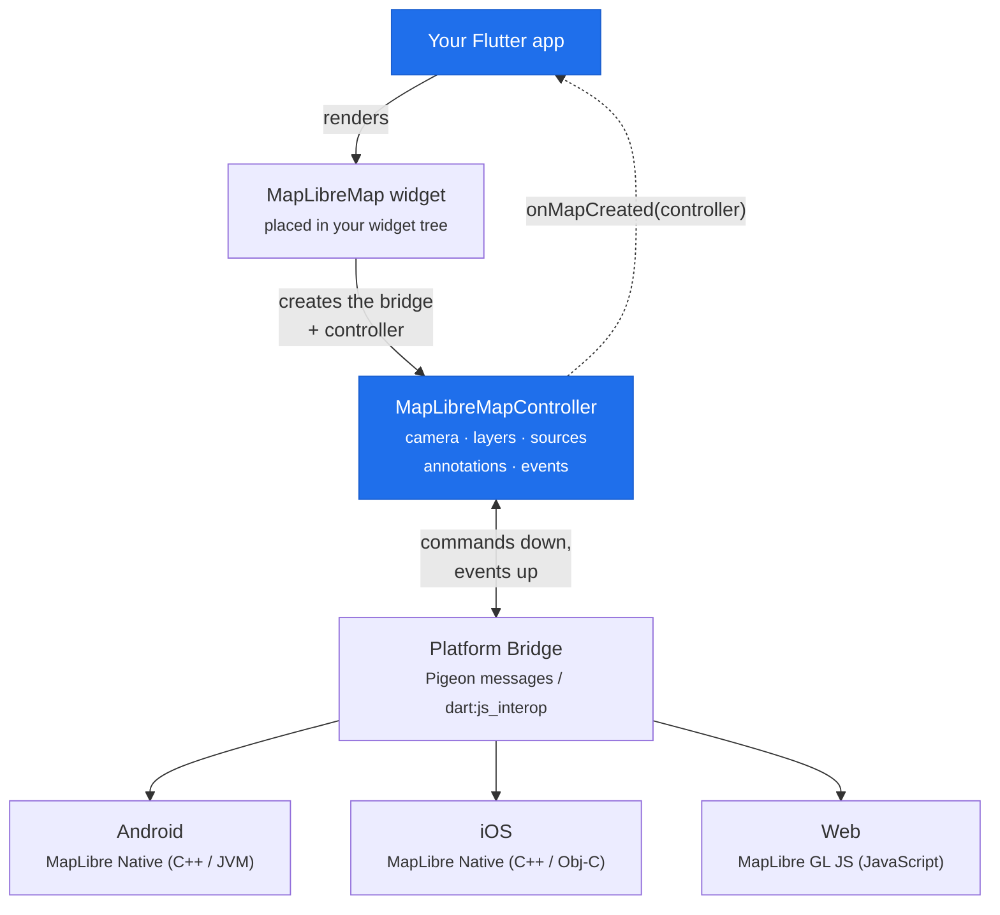
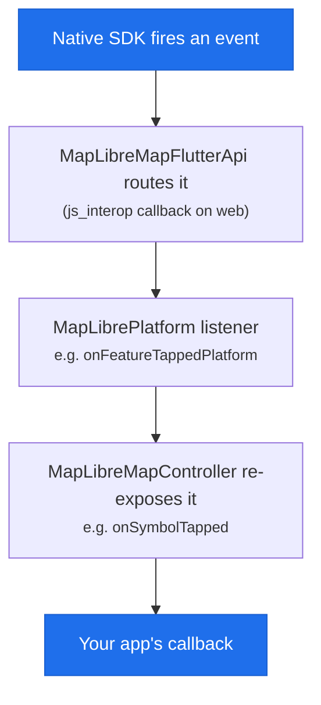

# Architecture

How a call travels from your Dart code to the map engine and back, and what that means for your app.

## The three-layer stack



### Layer 1: The Flutter widget

`MapLibreMap` embeds the map with a [Platform View](https://docs.flutter.dev/platform-integration/platform-views): the map engine draws it, not Flutter. [MapLibre Native](https://github.com/maplibre/maplibre-native) draws it on Android and iOS, MapLibre GL JS on web.

- Flutter widgets drawn over the map, in a `Stack`, work.
- Flutter widgets inside the map are not possible: use annotations or style layers.

### Layer 2: The controller

`MapLibreMapController` is the Dart-side handle to the running map. You get it in the `onMapCreated` callback:

```dart
MapLibreMap(
  onMapCreated: (MapLibreMapController controller) {
    // controller is now ready
  },
)
```

The controller is your handle to one map. It sends calls down (camera, layers, sources, annotations, queries, snapshots) and receives events back up (taps, drags, camera moves). Every call crosses to the map engine and is asynchronous, so `await` it.

### Layer 3: The platform bridge

- **Android, iOS**: typed [Pigeon](https://pub.dev/packages/pigeon) messages, generated from `maplibre_gl/pigeons/messages.dart`, give Dart, Kotlin and Swift one contract. Both platforms receive the same arguments and answer with the same results and [error codes](errors.md).
- **Web**: `dart:js_interop` calls MapLibre GL JS directly in the browser, behind the same controller API.

Each map has a `MapLibreMapHostApi` for the calls down and a `MapLibreMapFlutterApi` for the events up. The calls that need no map, such as offline regions, the ambient cache and HTTP headers, go through `MapLibreGlobalHostApi`.

??? info "Before 0.28.0: method channels"
    Up to 0.27.x, Android and iOS were reached through hand-written method channels: string method names and untyped maps, decoded separately in Kotlin, Java and Swift. A platform could read an argument differently or answer with its own error code, and tests mocked the channels.

    To move tests to the new bridge, see [Tests and platform packages](../migration.md#tests-and-platform-packages). The [0.27.1 version of this page](https://github.com/maplibre/flutter-maplibre-gl/blob/v0.27.1/website/docs/concepts/architecture.md) describes the old bridge.

## Platform differences

Some features are only available on certain platforms:

<div class="table-scroll" markdown>
<table class="comparison-table comparison-table--matrix">
  <thead>
    <tr><th>Feature</th><th>Android</th><th>iOS</th><th>Web</th></tr>
  </thead>
  <tbody>
    <tr><td>Offline regions</td><td><span class="cell-ic"><span class="ic ic--yes">✔</span></span></td><td><span class="cell-ic"><span class="ic ic--yes">✔</span></span></td><td><span class="cell-ic"><span class="ic ic--no">✘</span></span></td></tr>
    <tr><td>Hover events</td><td><span class="cell-ic"><span class="ic ic--no">✘</span></span></td><td><span class="cell-ic"><span class="ic ic--no">✘</span></span></td><td><span class="cell-ic"><span class="ic ic--yes">✔</span></span></td></tr>
  </tbody>
</table>
</div>

<span class="ic ic--yes">✔</span> supported &nbsp;·&nbsp; <span class="ic ic--no">✘</span> not available
{ .legend }

These are the differences the three-layer stack itself creates: offline caching lives in MapLibre Native, and hover exists only where there is a pointer. Everything else behaves the same, errors included. For the complete platform breakdown see the [Feature Matrix](../compare/feature-matrix.md).

Use `kIsWeb` from `package:flutter/foundation.dart` to guard platform-specific code:

```dart
import 'package:flutter/foundation.dart';

if (!kIsWeb) {
  // offline regions, etc.
}

if (kIsWeb) {
  // hover effects, etc.
}
```

### Platform views on Android

On Android the map is a platform view, and which embedding Flutter uses depends
on the Android `View` the map renders into. The default is fine for most apps;
[Startup & Performance](../advanced/performance.md#platform-view-mode-android)
covers when to change it.

## Callback lifecycle

Events flow the other way, from native up to your Dart callback:



Always check `if (mounted)` before calling `setState()` inside async callbacks, as the widget may have been disposed by the time the native callback arrives.

## Next steps

- [Annotations vs Style Layers](annotations-vs-layers.md): the two APIs for putting data on the map
- [Working with GeoJSON](geojson.md): the data format underlying everything
- [Errors](errors.md): the error codes every platform reports, and how to catch them
